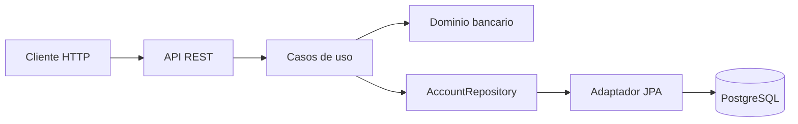

# Tonik Bank

<<<<<<< Updated upstream
Backend REST pequeño para gestionar cuentas bancarias y explorar decisiones de dominio, persistencia y transacciones con Java y Spring Boot.

El proyecto mantiene un alcance acotado: ofrece operaciones sobre cuentas mediante HTTP y conserva la lógica bancaria en un dominio separado de Spring y JPA. Su objetivo es servir como una implementación demostrable y como una base clara para futuras mejoras.

## Funcionalidad disponible

### API HTTP

| Método | Ruta | Descripción |
| --- | --- | --- |
| `POST` | `/api/accounts` | Abre una cuenta con saldo inicial y moneda. |
| `GET` | `/api/accounts/{accountId}` | Consulta una cuenta. |
| `POST` | `/api/accounts/{accountId}/debits` | Debita un monto de la cuenta. |
| `POST` | `/api/accounts/{accountId}/credits` | Acredita un monto a la cuenta. |

La transferencia entre cuentas está implementada como caso de uso transaccional en la capa de aplicación, pero todavía no está expuesta como endpoint HTTP.

### Decisiones del dominio y persistencia

- `Money` representa montos con `BigDecimal` y moneda.
- `BankAccount` protege sus invariantes de débito, crédito y estado.
- La aplicación separa la API, los casos de uso, el dominio y los adaptadores de persistencia.
- PostgreSQL persiste las cuentas; Flyway administra el esquema mediante migraciones.
- Las operaciones individuales de saldo y las transferencias usan transacciones y bloqueos pesimistas para coordinar cambios concurrentes.
- La suite automatizada cubre reglas del dominio, casos de uso, persistencia y límites transaccionales. Testcontainers permite ejecutar escenarios de integración con PostgreSQL.

## Arquitectura



El dominio no depende de Spring ni de la infraestructura de persistencia. La capa de aplicación coordina los casos de uso y define los límites transaccionales.

## Tecnologías

- Java 21
- Spring Boot
- Spring Data JPA e Hibernate
- PostgreSQL y Flyway
- Maven Wrapper
- JUnit, Mockito y Testcontainers
- Docker Compose para PostgreSQL local

## Ejecución local

Requisitos: Java 21 y Docker Desktop.

=======
Backend REST para gestionar cuentas bancarias y transferencias con Java 21 y Spring Boot. La aplicación separa las reglas del dominio de la API HTTP y de la persistencia, y usa PostgreSQL para conservar las cuentas.

## Funcionalidad

| Método | Ruta | Descripción |
| --- | --- | --- |
| `POST` | `/api/accounts` | Abre una cuenta con saldo inicial y moneda. |
| `GET` | `/api/accounts/{accountId}` | Consulta una cuenta. |
| `POST` | `/api/accounts/{accountId}/debits` | Debita un monto de la cuenta. |
| `POST` | `/api/accounts/{accountId}/credits` | Acredita un monto a la cuenta. |
| `POST` | `/api/transfers` | Transfiere fondos entre dos cuentas. |

- `Money` representa montos con `BigDecimal` y moneda.
- `BankAccount` protege las reglas de débito, crédito y saldo.
- Los casos de uso coordinan transacciones y persistencia.
- PostgreSQL conserva las cuentas y Flyway administra el esquema.
- Las mutaciones usan bloqueos pesimistas para coordinar cambios concurrentes.

## Arquitectura


El dominio no depende de Spring ni de JPA. La capa de aplicación coordina los casos de uso y sus límites transaccionales.

## Tecnologías

- Java 21 y Spring Boot
- Spring Data JPA e Hibernate
- PostgreSQL y Flyway
- Maven Wrapper
- JUnit, Mockito y Testcontainers
- Docker Compose

## Ejecución local

Requisitos: Java 21 y Docker Desktop.

>>>>>>> Stashed changes
Inicia PostgreSQL:

```powershell
docker compose up -d
```

Inicia la aplicación en Windows:

```powershell
.\mvnw.cmd spring-boot:run
```

<<<<<<< Updated upstream
La aplicación queda disponible en `http://localhost:8080`.
=======
La aplicación queda disponible en `http://localhost:8080`. Las cuentas se guardan en PostgreSQL.
>>>>>>> Stashed changes

### Abrir una cuenta

```powershell
$body = @{
    openingBalance = 100.00
    currency = 'USD'
} | ConvertTo-Json

Invoke-RestMethod `
    -Method Post `
    -Uri 'http://localhost:8080/api/accounts' `
    -ContentType 'application/json' `
    -Body $body
```

<<<<<<< Updated upstream
La respuesta incluye el identificador de la cuenta, que puedes usar en las rutas de consulta, débito y crédito.

### Ejecutar las pruebas

```powershell
.\mvnw.cmd `
    "-Dtest=BankAccountTest,MoneyTest,Money1Test,AccountApplicationServiceTest,AccountMutationConcurrencyIntegrationTest,TransferLockOrderingTest,TransferTransactionIntegrationTest,AccountJpaEntityMappingTest,PostgresAccountRepositoryTest" `
    test
```

Las pruebas de integración con PostgreSQL usan Testcontainers y requieren Docker.
=======
Guarda el `id` de la respuesta para consultar la cuenta o usarla en una operación de saldo.

### Transferir entre cuentas

Usa los identificadores de dos cuentas existentes. La operación responde `204 No Content` cuando termina correctamente.

```powershell
$body = @{
    sourceAccountId = 'UUID-CUENTA-ORIGEN'
    targetAccountId = 'UUID-CUENTA-DESTINO'
    amount = 25.00
    currency = 'USD'
} | ConvertTo-Json

Invoke-RestMethod `
    -Method Post `
    -Uri 'http://localhost:8080/api/transfers' `
    -ContentType 'application/json' `
    -Body $body
```

### Ejecutar pruebas de negocio e infraestructura

```powershell
.\mvnw.cmd `
    "-Dtest=BankAccountTest,MoneyTest,Money1Test,AccountApplicationServiceTest,TransferApplicationServiceTest,TransferTransactionIntegrationTest,AccountControllerTest,AccountHttpIntegrationTest,TransferControllerTest,TransferHttpIntegrationTest,AccountJpaEntityMappingTest,PostgresAccountRepositoryTest" `
    test
```

Las pruebas de integración con PostgreSQL usan Testcontainers y requieren Docker Desktop.
>>>>>>> Stashed changes

## Estructura

```text
src/main/java/com/toninitech/banking/
├── account/
│   ├── api/                 Endpoints, DTO y respuestas HTTP
│   ├── application/         Casos de uso y puertos
│   ├── domain/              Entidades, valores y reglas bancarias
<<<<<<< Updated upstream
│   └── infrastructure/      Adaptadores en memoria y JPA
└── shared/                  Tipos y manejo de errores compartidos

src/test/java/com/toninitech/banking/
└── account/                 Pruebas de dominio, aplicación, API y persistencia
```

## Alcance y próximos objetivos

Este proyecto es una demostración backend acotada; no es un sistema bancario listo para producción. Actualmente no incluye autenticación ni autorización, historial contable de movimientos, ni un endpoint HTTP de transferencia.

Los siguientes incrementos se evaluarán por separado, según su valor y alcance:

1. Exponer la transferencia existente mediante un contrato HTTP y documentar su uso.
2. Definir autenticación y autorización para las operaciones sobre cuentas.
3. Evaluar un historial auditable de movimientos y las garantías de idempotencia que necesite la API.

Kafka y la separación en microservicios quedan como alternativas futuras, sujetas a una necesidad de negocio y a límites de dominio que las justifiquen.
=======
│   └── infrastructure/      Adaptadores JPA
└── shared/                  Tipos y manejo de errores compartidos
```

## Alcance

Tonik Bank es un backend demostrativo acotado, no un sistema bancario listo para producción. No incluye autenticación ni autorización, historial contable de movimientos ni garantías de idempotencia para solicitudes repetidas. Esos objetivos pueden abordarse en incrementos futuros según las necesidades del proyecto.
>>>>>>> Stashed changes
